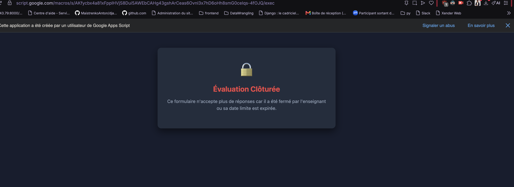

# ⏱️ FastQuiz-AntiIA — Évaluation Express & Anti-Triche

<p align="center">
  
  
  
  
  
</p>

<p align="center">
  <strong>Application Web pédagogique d'évaluation flash sous haute contrainte temporelle, conçue pour neutraliser l'usage des IA (ChatGPT) et éliminer les fuites de réponses entre pairs via WhatsApp.</strong>
</p>

---

## 📑 Sommaire

- [🎯 Présentation \& Problématique Pédagogique](#-présentation--problématique-pédagogique)
- [🛡️ L'Arsenal Anti-Triche \& Anti-Fuite](#️-larsenal-anti-triche--anti-fuite)
  - [1. Pression cognitive Anti-IA](#1-pression-cognitive-anti-ia)
  - [2. Verrouillage Anti-WhatsApp (Corrigé Différé)](#2-verrouillage-anti-whatsapp-corrigé-différé)
  - [3. Auto-Clôture Cloud par Trigger Horodateur](#3-auto-clôture-cloud-par-trigger-horodateur)
- [🔗 Accès à l'Application](#-accès-à-lapplication)
  - [🎓 Accès Étudiant](#-accès-étudiant)
  - [👨‍🏫 Accès Enseignant (Dashboard de Pilotage)](#-accès-enseignant-dashboard-de-pilotage)
- [📱 Aperçu \& Captures d'Écran](#-aperçu--captures-décran)
- [⚡ Fonctionnalités Clés](#-fonctionnalités-clés)
  - [🎓 Côté Étudiant](#-côté-étudiant)
  - [👨‍🏫 Côté Enseignant (`?view=admin`)](#-côté-enseignant-viewadmin)
  - [📬 Module d'Auto-Correction par E-mail](#-module-dauto-correction-par-e-mail)
- [🏗️ Architecture \& Flux de Données](#️-architecture--flux-de-données)
- [🛠️ Protocole de Reproductibilité (Guide Novice Pas à Pas)](#️-protocole-de-reproductibilité-guide-novice-pas-à-pas)
  - [Étape 1 : Créer la Base de Données Google Sheets](#étape-1--créer-la-base-de-données-google-sheets)
  - [Étape 2 : Configurer le Script (Code.gs)](#étape-2--configurer-le-script-codegs)
  - [Étape 3 : Créer l'Interface Utilisateur (index.html)](#étape-3--créer-linterface-utilisateur-indexhtml)
  - [Étape 4 : Déployer en Application Web](#étape-4--déployer-en-application-web)
  - [Étape 5 : Créer le QR Code \& Lien Court (TinyURL)](#étape-5--créer-le-qr-code--lien-court-tinyurl)
- [📖 Scénario Type d'Utilisation en Cours](#-scénario-type-dutilisation-en-cours)

---

## 🎯 Présentation & Problématique Pédagogique

Dans les formations d'enseignement supérieur technique (BTS Génie Civil / Bâtiment, classes préparatoires, licences), les contrôles continus en ligne traditionnels (Google Forms, QCM Moodle asynchrones) sont devenus caducs :
- **L'IA générative (ChatGPT, Gemini)** résout les questions en moins de 15 secondes si l'étudiant dispose de temps pour copier l'énoncé.
- **Les groupes WhatsApp de classe** permettent au premier étudiant ayant terminé de faire une capture d'écran de son récapitulatif pour transmettre les lettres gagnantes (`Q1: B, Q2: C...`) à l'ensemble de ses camarades.

**FastQuiz-AntiIA** anéantit ces deux vecteurs de fraude grâce à une architecture sans faille :
1. **Un chronomètre individuel de 10 secondes par question** avec défilement irréversible forcé.
2. **L'interdiction absolue d'envoyer les réponses par e-mail** pendant que la session est ouverte (la note s'affiche à l'écran, mais aucun corrigé n'est émis).
3. **Un robot Cloud automatique (`ScriptApp.newTrigger`)** qui clôture l'épreuve à la minute programmée (ex: 23h59) et expédie simultanément à chaque étudiant un **e-mail d'auto-correction exhaustif** avec les formules complètes et les rappels de cours.

---

## 🛡️ L'Arsenal Anti-Triche & Anti-Fuite

| Barrière de Sécurité | Mécanisme Technique | Effet Pédagogique Concret |
| :--- | :--- | :--- |
| **Pression temporelle extrême (10s)** | Minuteur JavaScript avec barre SVG/CSS fluide (`10s linear`) | Rend impossible le copier-coller vers une IA ou la recherche documentaire. L'étudiant répond au réflexe. |
| **Mélange Fisher-Yates** | `shuffleArray(questions)` côté client à chaque lancement | Deux voisins de table ou deux étudiants distants n'ont jamais les mêmes questions au même instant. |
| **Verrouillage du corrigé en session** | Suppression des flux de correction dans `submitQuiz()` | L'étudiant connaît sa note brute, mais n'a **aucun moyen de savoir quelles questions il a réussies ou ratées**, rendant tout partage d'informations inutile. |
| **Protection côté serveur** | Les bonnes réponses (`Col F`) ne sont jamais injectées dans le DOM | L'inspection du code source via l'outil DevTools du navigateur (`F12`) est totalement inopérante. |
| **Anti-Copier / Coller / Clic Droit** | Écouteurs `copy`, `paste` bloqués et `oncontextmenu="return false;"` | Neutralise la capture textuelle immédiate de l'énoncé. |
| **Contrôle d'unicité d'émargement** | Vérification insensible à la casse sur la colonne `Email` | Impossibilité pour un étudiant de repasser le test sous la même identité. |
| **Trigger Cloud Auto-Clôture** | Déclencheur temporel asynchrone Google Apps Script | Clôture automatique et envoi groupé des corrigés à l'heure précise (ex: 23h59), même si le professeur a son ordinateur éteint. |

---

## 🔗 Accès à l'Application

### 🎓 Accès Étudiant
- **Lien direct court :** `https://tinyurl.com/mon-quizz` (ou votre alias personnalisé)
- **Support mobile :** Accès immédiat via QR Code projeté en classe ou partagé sur le tableau de bord pédagogique.

### 👨‍🏫 Accès Enseignant (Dashboard de Pilotage)
Pour ouvrir le tableau de bord de débriefing en direct, ajoutez le paramètre d'URL `?view=admin` à la fin du lien de votre application web :
```text
https://script.google.com/macros/s/VOTRE_DEPLOYMENT_ID/exec?view=admin
```

---

## 📱 Aperçu & Captures d'Écran

<div align="center">

### 1. Écran d'accueil Étudiant (avec compte à rebours dynamique live)


*L'étudiant renseigne Nom, Prénom, E-mail et visualise le temps exact restant avant la fermeture définitive de la session.*

---

### 2. Dashboard Enseignant (`?view=admin`)


*Statut de la session en direct, programmation de l'heure limite, KPIs de la classe, distribution des réponses avec révélation des noms au clic.*

---

### 3. Flash d'Auto-Correction reçu par E-mail à la Clôture


*L'étudiant reçoit son bilan personnalisé : formule exacte choisie, formule exacte attendue (en vert) et encadré « 💡 Rappel du cours » pour travailler ses lacunes en autonomie.*

---

### 4. Écran de Clôture Sécurisé & QR Code d'Accès



</div>

---

## ⚡ Fonctionnalités Clés

### 🎓 Côté Étudiant
- **Zéro friction :** Ne nécessite aucun compte Google obligatoire, aucune application à installer. Fonctionne sur n'importe quel navigateur (Chrome, Safari, Firefox, Edge).
- **Compte à rebours de clôture dynamique :** Affiche en temps réel le décompte (`XXj XXh XXm XXs`) jusqu'à l'heure fatidique configurée par l'enseignant.
- **Navigation automatique à haute vitesse :** Un clic sur une option sélectionne la réponse avec un retour visuel bleu (`selected`), attend 350 ms pour confirmation, puis passe automatiquement à la question suivante.
- **Passe-partout anti-blocage :** Si le timer de 10s expire, le système enregistre une absence de réponse et bascule instantanément sur la suivante.
- **Accusé de réception sans fuite :** Note brute affichée instantanément sur 20 à la fin, avec mention sécurisante informant que le corrigé détaillé sera acheminé par e-mail à la fermeture de la session.

### 👨‍🏫 Côté Enseignant (`?view=admin`)
- **Indicateurs KPI globaux :** Taux de participation effectif, moyenne générale sur 20, note médiane, score maximal et score minimal.
- **Analyse statistique par question :** Histogramme horizontal dynamique représentant le pourcentage de sélection de chaque option (vert pour la réponse exacte, gris pour les distracteurs).
- **Identification nominative des erreurs :** Un clic sur n'importe quelle barre de choix déplie le tiroir listant les étudiants exacts ayant commis cette confusion. Idéal pour animer le débriefing au tableau.
- **Pilotage de session 2-en-1 :**
  - *Mode Manuel :* Bouton `Fermer maintenant` / `Ouvrir maintenant`.
  - *Mode Automatique :* Programmateur de date/heure (`datetime-local`) activant un trigger Cloud Google.
- **Bouton d'envoi immédiat de secours :** `📧 Envoyer les corrigés maintenant` pour forcer la distribution des e-mails en fin de cours sans attendre minuit.

### 📬 Module d'Auto-Correction par E-mail
Dès la fermeture, le système construit pour chaque participant un e-mail HTML soigné :
- **Intitulé complet de la question.**
- **Choix de l'élève en clair** (texte de la formule, coloré en vert si valide, en rouge si erroné).
- **Formule attendue en clair** (texte complet de l'option officielle).
- **Encadré pédagogique mémo :** Rappel formel de la règle mathématique à retenir pour réviser avant le prochain cours.

---

## 🏗️ Architecture & Flux de Données

```text
       [ SMARTPHONE ÉTUDIANT ]                     [ VIDÉOPROJECTEUR / PROF ]
                  │                                            │
                  ▼                                            ▼
       ┌────────────────────────┐                   ┌────────────────────────┐
       │   Interface Candidat   │                   │  Console Superviseur   │
       │  - Minuteur 10s        │                   │  (?view=admin)         │
       │  - Shuffler questions  │                   │  - KPI & Histogrammes  │
       │  - Timer clôture live  │                   │  - Programmateur date  │
       └──────────┬─────────────┘                   └──────────▲─────────────┘
                  │                                            │
                  │ (Soumission sans corrigé)                  │ (Polling Stats)
                  ▼                                            │
┌──────────────────────────────────────────────────────────────┴─────────────┐
│                    BACKEND GOOGLE APPS SCRIPT (Serverless)                 │
│                                                                            │
│  • doGet()                 : Aiguillage des vues selon ?view=admin         │
│  • submitQuiz()            : Calcul note, archivage (0 e-mail envoyé)     │
│  • setupAutoCloseTrigger() : Enregistrement du robot temporel Google       │
│  • autoCloseAndSendEmails(): Déclencheur Cloud (Ferme & lance l'envoi)     │
│  • sendAllCorrections()    : Construction des fiches HTML & MailApp        │
└──────────────────────────────────────┬─────────────────────────────────────┘
                                       │
                 ┌─────────────────────┴─────────────────────┐
                 ▼                                           ▼
┌─────────────────────────────────┐         ┌────────────────────────────────┐
│   GOOGLE SHEETS (Base de données)│         │     GMAIL / SERVEUR SMTP       │
│                                 │         │                                │
│ • Onglet 'Questions' : Banque   │         │ • Distribution des fiches      │
│ • Onglet 'Reponses'  : Émargement│        │   d'auto-correction complètes  │
│   notes et choix bruts élèves   │         │   (différées à la clôture)     │
└─────────────────────────────────┘         └────────────────────────────────┘
```

---

## 🛠️ Protocole de Reproductibilité (Guide Novice Pas à Pas)

Ce guide permet à tout enseignant, même sans compétences en programmation, de déployer son propre clone de l'application en moins de 10 minutes.

### Étape 1 : Créer la Base de Données Google Sheets
1. Rendez-vous sur [Google Sheets](https://sheets.new) et créez un nouveau classeur nommé **`QCM_Anti_IA`**.
2. Renommez la première feuille en **`Questions`** (respectez scrupuleusement la casse, avec un **Q** majuscule).
3. Remplissez la première ligne avec les en-têtes suivants :
   - `A1` : `ID (Col A)`
   - `B1` : `Question (Col B)`
   - `C1` : `Choix A (Col C)`
   - `D1` : `Choix B (Col D)`
   - `E1` : `Choix C (Col E)`
   - `F1` : `Bonne Reponse (Col F)`
4. Collez votre série de 10 questions à partir de la ligne `A2` (voir banques de questions fournies dans le cours).
5. Créez un deuxième onglet nommé exactement **`Reponses`** (sans accent sur le 'e').
6. Remplissez la ligne 1 de l'onglet `Reponses` avec :
   `Date` | `Nom` | `Prenom` | `Email` | `Score` | `Q1` | `Q2` | `Q3` | `Q4` | `Q5` | `Q6` | `Q7` | `Q8` | `Q9` | `Q10`

---

### Étape 2 : Configurer le Script (Code.gs)
1. Dans votre feuille de calcul, cliquez sur le menu **Extensions** > **Apps Script**.
2. Renommez le projet en haut à gauche : **`FastQuiz_Engine`**.
3. Ouvrez le fichier `Code.gs` et remplacez l'intégralité du code par le contenu officiel :

```javascript
// ==================== POINT D'ENTRÉE ====================
function doGet(e) {
  const isAdmin = (e && e.parameter && e.parameter.view === 'admin');
  const template = HtmlService.createTemplateFromFile('index');
  
  const config = getQuizConfig();
  const now = new Date().getTime();
  let isClosed = (config.status === "CLOSED");
  
  if (config.closeTime && now > new Date(config.closeTime).getTime()) {
    isClosed = true;
  }

  template.isAdmin = isAdmin;
  template.isClosed = isClosed;
  template.config = config;
  template.questionsData = getQuestions();
  template.adminStats = isAdmin ? getAdminStats() : null;
  
  return template.evaluate()
    .setTitle(isAdmin ? "📊 Débriefing Enseignant" : "⏱️ Évaluation")
    .addMetaTag('viewport', 'width=device-width, initial-scale=1')
    .setXFrameOptionsMode(HtmlService.XFrameOptionsMode.ALLOWALL);
}

// ==================== GESTION DE CONFIGURATION ====================
function getQuizConfig() {
  const props = PropertiesService.getScriptProperties();
  return {
    status: props.getProperty("QUIZ_STATUS") || "OPEN",
    closeTime: props.getProperty("QUIZ_CLOSE_TIME") || "",
    emailsSent: props.getProperty("EMAILS_ALREADY_SENT") || "false"
  };
}

function updateQuizConfig(status, closeTime) {
  const props = PropertiesService.getScriptProperties();
  props.setProperty("QUIZ_STATUS", status);
  props.setProperty("QUIZ_CLOSE_TIME", closeTime || "");

  if (status === "OPEN") {
    props.setProperty("EMAILS_ALREADY_SENT", "false");
  }

  setupAutoCloseTrigger(closeTime, status);
  return { success: true, status: status, closeTime: closeTime };
}

function setupAutoCloseTrigger(closeTimeStr, status) {
  deleteTriggersByName('autoCloseAndSendEmails');
  if (status === "CLOSED" || !closeTimeStr) return;

  const closeDate = new Date(closeTimeStr);
  const now = new Date().getTime();

  if (closeDate.getTime() > now) {
    ScriptApp.newTrigger('autoCloseAndSendEmails')
      .timeBased()
      .at(closeDate)
      .create();
  }
}

function deleteTriggersByName(functionName) {
  const triggers = ScriptApp.getProjectTriggers();
  for (let i = 0; i < triggers.length; i++) {
    if (triggers[i].getHandlerFunction() === functionName) {
      ScriptApp.deleteTrigger(triggers[i]);
    }
  }
}

function autoCloseAndSendEmails() {
  const props = PropertiesService.getScriptProperties();
  props.setProperty("QUIZ_STATUS", "CLOSED");
  sendAllCorrections();
  deleteTriggersByName('autoCloseAndSendEmails');
}

// ==================== TRAITEMENT DES QUESTIONS ====================
function getQuestions() {
  const sheet = SpreadsheetApp.getActiveSpreadsheet().getSheetByName("Questions");
  const data = sheet.getDataRange().getDisplayValues();
  const questions = [];
  
  for (let i = 1; i < data.length; i++) {
    questions.push({
      id: data[i][0],
      question: data[i][1],
      options: [
        { key: 'A', text: data[i][2] },
        { key: 'B', text: data[i][3] },
        { key: 'C', text: data[i][4] }
      ]
    });
  }
  return questions;
}

function checkEmailExists(email) {
  const sheet = SpreadsheetApp.getActiveSpreadsheet().getSheetByName("Reponses");
  const data = sheet.getDataRange().getValues();
  const cleanEmail = String(email).trim().toLowerCase();
  
  for (let i = 1; i < data.length; i++) {
    if (String(data[i][3]).trim().toLowerCase() === cleanEmail) {
      return true;
    }
  }
  return false;
}

// Soumission avec affichage de la note mais SANS envoi immédiat de mail
function submitQuiz(studentData, answers) {
  const config = getQuizConfig();
  const now = new Date().getTime();
  if (config.status === "CLOSED" || (config.closeTime && now > new Date(config.closeTime).getTime())) {
    return { error: "Le test est clos. Votre soumission a expiré." };
  }

  if (checkEmailExists(studentData.email)) {
    return { error: "Tentative multiple détectée. Vous avez déjà soumis ce test !" };
  }

  const ss = SpreadsheetApp.getActiveSpreadsheet();
  const qSheet = ss.getSheetByName("Questions");
  const rSheet = ss.getSheetByName("Reponses");

  const qData = qSheet.getDataRange().getDisplayValues();
  let correctCount = 0;
  const totalQuestions = qData.length - 1;
  let studentAnswersRow = [];

  for (let i = 1; i < qData.length; i++) {
    const qId = qData[i][0];
    const realAnswer = String(qData[i][5]).trim().toUpperCase();
    const studentAnswer = answers[qId] ? String(answers[qId]).trim().toUpperCase() : "-";

    studentAnswersRow.push(studentAnswer);
    if (studentAnswer === realAnswer) correctCount++;
  }

  const scoreOn20 = Math.round(((correctCount / totalQuestions) * 20) * 100) / 100;

  rSheet.appendRow([
    new Date(),
    studentData.nom,
    studentData.prenom,
    studentData.email,
    scoreOn20,
    ...studentAnswersRow
  ]);

  return { score: scoreOn20, total: totalQuestions, correct: correctCount };
}

// ==================== DIFFUSION DU CORRIGÉ DÉTAILLÉ ====================
function sendAllCorrections() {
  const props = PropertiesService.getScriptProperties();
  const ss = SpreadsheetApp.getActiveSpreadsheet();
  const qSheet = ss.getSheetByName("Questions");
  const rSheet = ss.getSheetByName("Reponses");
  if (!qSheet || !rSheet) return 0;

  const qData = qSheet.getDataRange().getDisplayValues();
  const rData = rSheet.getDataRange().getDisplayValues();
  if (rData.length <= 1) return 0;

  const totalQuestions = qData.length - 1;
  let sentCount = 0;

  // Dictionnaire des rappels de cours associés à chaque question
  const explications = {
    1: "La formule de Leibniz donne la dérivée n-ième d'un produit (u·v). Elle utilise les coefficients binomiaux C(n,k).",
    2: "Chaque dérivation de e^(ax) multiplie par la constante a. À l'ordre n, le coefficient est aⁿ.",
    3: "Avec a = -3, la dérivée n-ième s'écrit (-3)ⁿ e^(-3x) = (-1)ⁿ 3ⁿ e^(-3x).",
    4: "Pour 1/(x+a), chaque dérivation apporte un signe négatif et incrémente le degré au dénominateur : (-1)ⁿ n! / (x+a)ⁿ⁺¹.",
    5: "La dérivée première de ln(x+a) étant 1/(x+a), les dérivations suivantes présentent un décalage d'un cran : (-1)ⁿ⁻¹ (n-1)! / (x+a)ⁿ.",
    6: "Dériver cos(ax) introduit une rotation de +π/2 dans le plan trigonométrique : aⁿ cos(ax + nπ/2).",
    7: "De même pour sin(ax), la dérivée d'ordre n vaut aⁿ sin(ax + nπ/2).",
    8: "Une fonction est de classe Cⁿ si elle est n fois dérivable ET que sa dérivée d'ordre n est continue.",
    9: "La dérivée d'ordre n d'un polynôme de degré d est identiquement nulle dès que n > d.",
    10: "Par combinaison, C(n, 1) = n! / (1! (n-1)!) = n."
  };

  for (let r = 1; r < rData.length; r++) {
    const studentNom = rData[r][1];
    const studentPrenom = rData[r][2];
    const studentEmail = String(rData[r][3]).trim();
    const scoreOn20 = rData[r][4];

    if (!studentEmail || !studentEmail.includes("@")) continue;

    let correctCount = 0;
    let questionsCardsHtml = "";

    for (let q = 1; q <= totalQuestions; q++) {
      const qTitle = qData[q][1];
      const optA = qData[q][2];
      const optB = qData[q][3];
      const optC = qData[q][4];
      const realAnswerKey = String(qData[q][5]).trim().toUpperCase();

      const studentKey = String(rData[r][4 + q] || "-").trim().toUpperCase();
      const isCorrect = (studentKey === realAnswerKey);
      if (isCorrect) correctCount++;

      let studentText = "Temps écoulé (Non répondu)";
      if (studentKey === 'A') studentText = `A. ${optA}`;
      else if (studentKey === 'B') studentText = `B. ${optB}`;
      else if (studentKey === 'C') studentText = `C. ${optC}`;

      let realText = "";
      if (realAnswerKey === 'A') realText = `A. ${optA}`;
      else if (realAnswerKey === 'B') realText = `B. ${optB}`;
      else if (realAnswerKey === 'C') realText = `C. ${optC}`;

      const astuce = explications[q] || "Formule fondamentale du chapitre à maîtriser par cœur.";

      questionsCardsHtml += `
        <div style="background: #ffffff; border: 1px solid #e2e8f0; border-left: 5px solid ${isCorrect ? '#16a34a' : '#dc2626'}; border-radius: 8px; padding: 14px; margin-bottom: 14px;">
          <div style="font-size: 14px; font-weight: bold; color: #1e293b; margin-bottom: 8px;">
            Q${q}. ${qTitle}
          </div>
          <div style="font-size: 13px; margin: 4px 0;">
            <span style="color: #64748b;">Votre choix :</span> 
            <strong style="color: ${isCorrect ? '#16a34a' : '#dc2626'};">${studentText}</strong> ${isCorrect ? '✅' : '❌'}
          </div>
          ${!isCorrect ? `
          <div style="font-size: 13px; margin: 4px 0;">
            <span style="color: #64748b;">Réponse correcte attendue :</span> 
            <strong style="color: #16a34a;">${realText}</strong>
          </div>` : ''}
          <div style="font-size: 12px; background: #f8fafc; border-radius: 5px; padding: 8px; margin-top: 8px; color: #334155;">
            💡 <strong>Rappel du cours :</strong> ${astuce}
          </div>
        </div>
      `;
    }

    try {
      MailApp.sendEmail({
        to: studentEmail,
        subject: `Corrigé Détaillé du QCM : ${scoreOn20}/20 - ${studentPrenom} ${studentNom}`,
        htmlBody: `
          <div style="font-family: Arial, sans-serif; max-width: 650px; margin: auto; border: 1px solid #e2e8f0; border-radius: 10px; overflow: hidden; background: #f8fafc;">
            <div style="background-color: #0f172a; color: white; padding: 22px; text-align: center;">
              <h2 style="margin: 0; color: #38bdf8;">Corrigé Officiel & Auto-Évaluation</h2>
              <p style="margin: 6px 0 0; color: #cbd5e1;">Étudiant : <strong>${studentPrenom} ${studentNom}</strong></p>
            </div>
            <div style="padding: 22px;">
              <div style="text-align: center; background: white; padding: 16px; border-radius: 8px; border: 1px solid #e2e8f0; margin-bottom: 20px;">
                <div style="font-size: 34px; font-weight: bold; color: ${parseFloat(scoreOn20) >= 10 ? '#16a34a' : '#dc2626'};">
                  ${scoreOn20} / 20
                </div>
                <div style="color: #64748b; font-size: 14px; margin-top: 4px;">
                  ${correctCount} réponse(s) exacte(s) sur ${totalQuestions}
                </div>
              </div>
              <p style="font-size: 14px; color: #475569; margin-bottom: 15px;">
                Consultez le détail de vos réponses et les formules officielles ci-dessous :
              </p>
              ${questionsCardsHtml}
              <div style="text-align: center; font-size: 12px; color: #94a3b8; margin-top: 25px;">
                Mathématiques — Classe de 2A BTS Bâtiment / Génie Civil
              </div>
            </div>
          </div>`
      });
      sentCount++;
    } catch (err) {
      Logger.log("Erreur mail à " + studentEmail + " : " + err);
    }
  }

  props.setProperty("EMAILS_ALREADY_SENT", "true");
  return sentCount;
}

// ==================== STATISTIQUES CONSOLE PROF ====================
function getAdminStats() {
  const ss = SpreadsheetApp.getActiveSpreadsheet();
  const qSheet = ss.getSheetByName("Questions");
  const rSheet = ss.getSheetByName("Reponses");
  if (!qSheet || !rSheet) return null;

  const qData = qSheet.getDataRange().getDisplayValues();
  const rData = rSheet.getDataRange().getDisplayValues();
  const studentsCount = rData.length > 1 ? rData.length - 1 : 0;

  const scores = [];
  for (let i = 1; i < rData.length; i++) {
    const s = parseFloat(rData[i][4]);
    if (!isNaN(s)) scores.push(s);
  }

  scores.sort((a, b) => a - b);
  const avg = scores.length ? (scores.reduce((a, b) => a + b, 0) / scores.length).toFixed(2) : 0;
  let median = 0;
  if (scores.length) {
    const mid = Math.floor(scores.length / 2);
    median = scores.length % 2 !== 0 ? scores[mid] : ((scores[mid - 1] + scores[mid]) / 2).toFixed(1);
  }

  const questionsStats = [];
  const totalQ = qData.length - 1;

  for (let q = 1; q <= totalQ; q++) {
    const qTitle = qData[q][1];
    const correctKey = String(qData[q][5]).trim().toUpperCase();
    
    const options = [
      { key: 'A', text: qData[q][2], count: 0, students: [] },
      { key: 'B', text: qData[q][3], count: 0, students: [] },
      { key: 'C', text: qData[q][4], count: 0, students: [] }
    ];
    let unanswered = { count: 0, students: [] };

    const colIndex = 4 + q;
    for (let r = 1; r < rData.length; r++) {
      const studentName = `${rData[r][2]} ${rData[r][1]}`.trim();
      const ans = String(rData[r][colIndex] || "").trim().toUpperCase();
      
      const opt = options.find(o => o.key === ans);
      if (opt) {
        opt.count++;
        opt.students.push(studentName);
      } else {
        unanswered.count++;
        unanswered.students.push(studentName);
      }
    }

    const correctOpt = options.find(o => o.key === correctKey);
    const correctCount = correctOpt ? correctOpt.count : 0;
    const successRate = studentsCount > 0 ? ((correctCount / studentsCount) * 100).toFixed(1) : 0;

    questionsStats.push({
      num: q,
      title: qTitle,
      correctKey: correctKey,
      successRate: successRate,
      correctCount: correctCount,
      options: options,
      unanswered: unanswered
    });
  }

  return {
    studentsCount: studentsCount,
    average: avg,
    median: median,
    max: scores.length ? Math.max(...scores) : 0,
    min: scores.length ? Math.min(...scores) : 0,
    questions: questionsStats
  };
}
```

---

### Étape 3 : Créer l'Interface Utilisateur (index.html)
1. Dans l'éditeur Apps Script, cliquez sur le **`+`** à côté de *Fichiers* et sélectionnez **HTML**.
2. Nommez le fichier exactement : **`index`** (sans extension `.html`).
3. Collez l'intégralité du code HTML/CSS/JS fourni dans le projet.

---

### Étape 4 : Déployer en Application Web
1. Cliquez en haut à droite sur le bouton bleu **Déployer** > **Nouveau déploiement**.
2. Cliquez sur l'icône d'engrenage ⚙️ et choisissez **Application Web**.
3. Configurez les options :
   - **Description :** `Version 1.0 Production`
   - **Exécuter en tant que :** `Moi` (votre adresse Gmail)
   - **Qui a accès :** `Tout le monde` (*Anyone* — indispensable pour que les étudiants n'aient pas besoin de s'authentifier).
4. Cliquez sur **Déployer**.
5. Autorisez les permissions d'accès demandées par Google (*Paramètres avancés > Accéder à FastQuiz_Engine (non sécurisé)*).
6. Copiez l'**URL de l'application Web** qui se termine par `/exec`.

---

### Étape 5 : Créer le QR Code & Lien Court (TinyURL)
1. Rendez-vous sur [TinyURL.com](https://tinyurl.com).
2. Collez votre URL longue `/exec`.
3. Choisissez un alias parlant (ex : `mon-quizz` ou `bts-gc-bat`).
4. Téléchargez le QR Code généré pour le projeter au tableau en classe.
5. Pour votre usage personnel enseignant, ajoutez simplement `?view=admin` à la fin de l'URL pour vos favoris.

---

## 📖 Scénario Type d'Utilisation en Cours

```text
[ DÉBUT DU COURS ]
 ├── 1. Le professeur ouvre son lien admin (?view=admin).
 ├── 2. Il programme l'heure limite de fin d'épreuve (ex: "Aujourd'hui à 12h15").
 ├── 3. Il clique sur "Enregistrer" : Google planifie l'envoi automatique.
 └── 4. Le professeur affiche le QR code au vidéoprojecteur.

[ PENDANT LE TEST (10-15 minutes) ]
 ├── Les étudiants scannent le QR code avec leur smartphone.
 ├── Ils composent à une cadence de 10 secondes par question.
 ├── À la fin, chaque élève découvre sa note (ex: 14/20), mais AUCUN corrigé n'est émis.
 └── Le professeur observe en direct la moyenne et les graphiques monter sur son écran.

[ CLÔTURE DE L'ÉPREUVE ]
 ├── Option A : L'heure programmée (12h15) sonne. Le robot cloud ferme le test tout seul.
 └── Option B : Tous les élèves ont fini plus tôt. Le professeur clique sur "Fermer maintenant",
     puis sur "📧 Envoyer les corrigés maintenant".

[ DÉBRIEFING IMMÉDIAT OU COURS SUIVANT ]
 ├── Tous les étudiants ouvrent leur boîte e-mail et analysent leurs erreurs en couleur.
 └── L'enseignant projette le dashboard prof, clique sur les distracteurs fréquents
     et réexplique précisément les théorèmes qui ont posé problème.
```

---

<p align="center">
  <strong>Projet Open Source conçu pour l'Excellence Pédagogique en BTS Bâtiment & Travaux Publics.</strong><br>
  <em>Développé pour un enseignement moderne, juste et libéré de la fraude aux IA génératives.</em>
</p>
