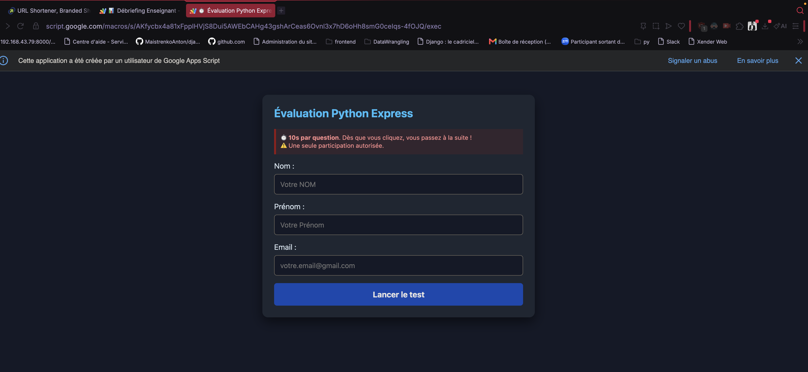
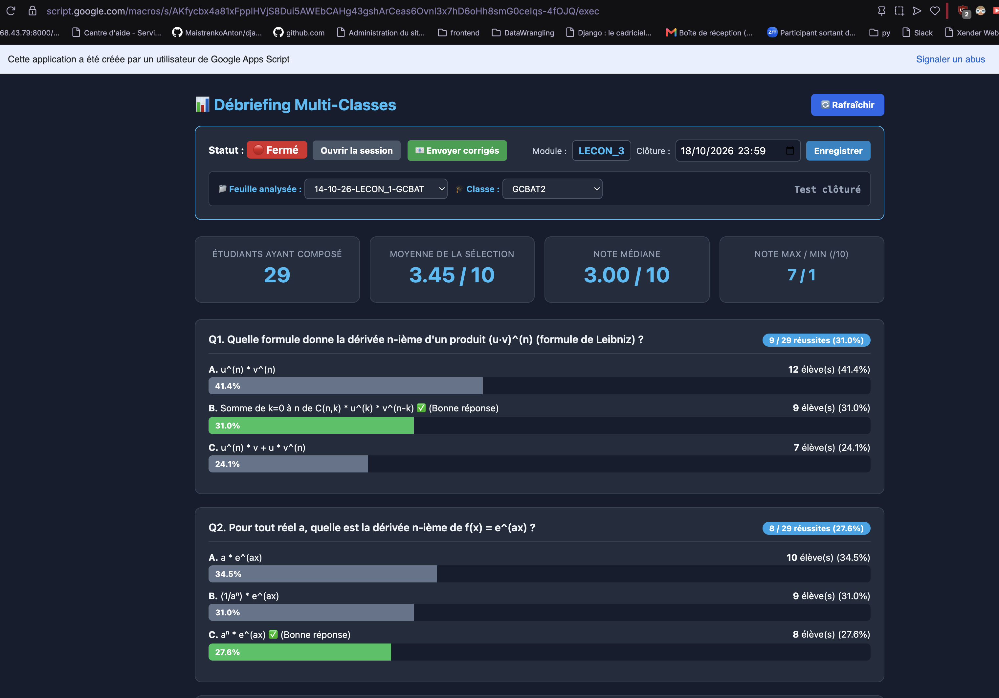
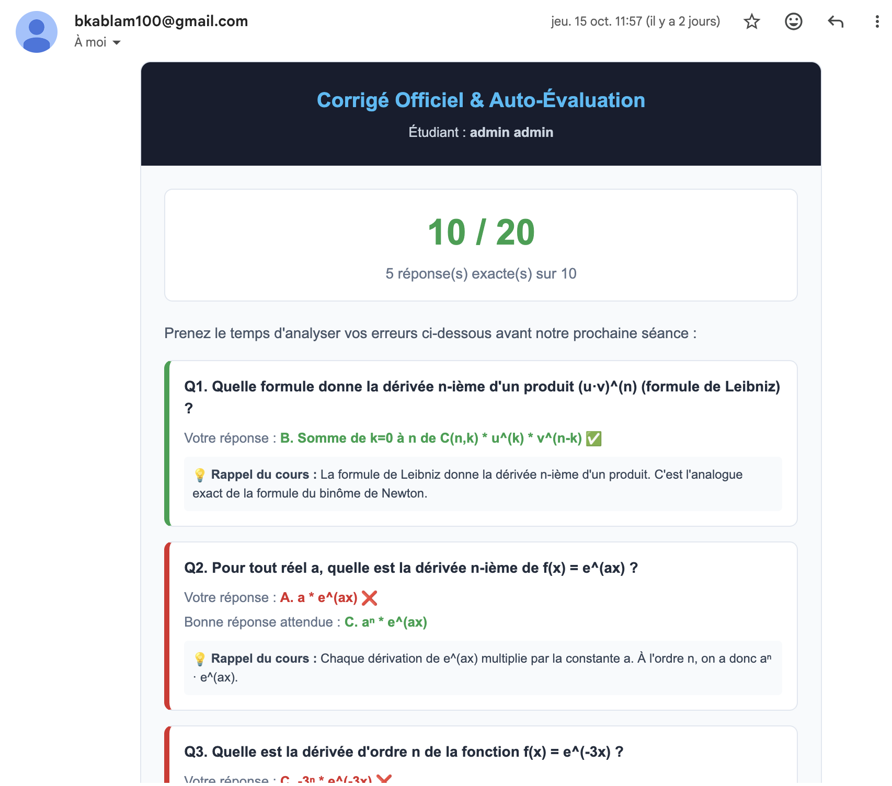

# ⏱️ FastQuiz-AntiIA — Évaluation Express, Multi-Filières & Anti-Triche

<p align="center">
  
  
  
  
  
  
</p>

<p align="center">
  <strong>Application Web pédagogique d'évaluation flash sous haute contrainte temporelle, conçue pour neutraliser l'usage des IA génératives (ChatGPT, Gemini), éliminer les fuites de corrigés via WhatsApp et automatiser le tri des notes par filière.</strong>
</p>

---

## 📑 Sommaire

- [⏱️ FastQuiz-AntiIA — Évaluation Express, Multi-Filières \& Anti-Triche](#️-fastquiz-antiia--évaluation-express-multi-filières--anti-triche)
  - [📑 Sommaire](#-sommaire)
  - [🎯 Présentation \& Défi Pédagogique](#-présentation--défi-pédagogique)
  - [🛡️ L'Arsenal Anti-Fraude](#️-larsenal-anti-fraude)
  - [🏫 Architecture Multi-Classes Spécifique](#-architecture-multi-classes-spécifique)
  - [📊 Barème \& Notation Officielle (/ 10)](#-barème--notation-officielle--10)
  - [🔗 Accès à l'Application](#-accès-à-lapplication)
    - [🎓 Côté Étudiant](#-côté-étudiant)
    - [👨‍🏫 Côté Enseignant (`?view=admin`)](#-côté-enseignant-viewadmin)
  - [📱 Captures d'Écran](#-captures-décran)
    - [1. Accueil Étudiant \& Sélection de Filière](#1-accueil-étudiant--sélection-de-filière)
    - [2. Dashboard Enseignant Multi-Classes (Hot-Reload)](#2-dashboard-enseignant-multi-classes-hot-reload)
    - [3. E-mail de Corrigé Pédagogique Différé (Reçu à 23h59)](#3-e-mail-de-corrigé-pédagogique-différé-reçu-à-23h59)
  - [⚡ Cycle de Vie Automatique \& Archivage Anti-Doublon](#-cycle-de-vie-automatique--archivage-anti-doublon)
  - [🏗️ Schéma d'Architecture](#️-schéma-darchitecture)
  - [🛠️ Protocole d'Installation \& Reproductibilité (Guide Novice)](#️-protocole-dinstallation--reproductibilité-guide-novice)
    - [Étape 1 : Structurer le Classeur Google Sheets](#étape-1--structurer-le-classeur-google-sheets)
    - [Étape 2 : Implanter le Backend (`Code.gs`)](#étape-2--implanter-le-backend-codegs)
    - [Étape 3 : Implanter le Frontend (`index.html`)](#étape-3--implanter-le-frontend-indexhtml)
    - [Étape 4 : Déployer en Application Web](#étape-4--déployer-en-application-web)
  - [📖 Scénario Type d'une Journée de Cours](#-scénario-type-dune-journée-de-cours)
  - [🚀 Roadmap \& Améliorations Futures](#-roadmap--améliorations-futures)
    - [1. Rendu Mathématique Léger (KaTeX Serverless)](#1-rendu-mathématique-léger-katex-serverless)
    - [2. Export Automatisé des Notes (Bulletins \& PDF)](#2-export-automatisé-des-notes-bulletins--pdf)
    - [3. Banques de Questions Dynamiques (Random Pull)](#3-banques-de-questions-dynamiques-random-pull)
    - [4. Authentification par Numéro Matricule Étudiant](#4-authentification-par-numéro-matricule-étudiant)
    - [5. Détection de Perte de Focus (Anti-Split Screen)](#5-détection-de-perte-de-focus-anti-split-screen)
    - [6. Mode Hors-Ligne Partiel (Progressive Web App - PWA)](#6-mode-hors-ligne-partiel-progressive-web-app---pwa)

---

## 🎯 Présentation & Défi Pédagogique

Dans l'enseignement supérieur technique (BTS Génie Civil, Informatique IDA, Finance FCGE, classes préparatoires), les QCM asynchrones classiques (Google Forms, Moodle) ne permettent plus d'évaluer fidèlement les connaissances :
1. **L'IA générative (ChatGPT, Claude, Gemini)** fournit la réponse en 10 secondes dès lors que l'étudiant peut copier le texte.
2. **Les groupes WhatsApp d'étudiants** permettent au premier ayant terminé de diffuser une capture d'écran des réponses aux autres.
3. **Le casse-tête multi-classes :** Gérer plusieurs filières avec des questions différentes et des emplois du temps distincts conduit souvent à écraser ou mélanger les résultats.

**FastQuiz-AntiIA** apporte une réponse systémique :
* **Cadence forcée de 10 secondes par question** (réflexe pur, zéro temps de triche).
* **Barème clair noté sur 10** (10 questions, 1 point par réponse correcte).
* **Zéro corrigé envoyé avant la clôture officielle** (la note brute s'affiche, mais aucune solution n'est divulguée dans le code client).
* **Support natif de plusieurs filières** sur un seul lien avec routage automatique des questions.
* **Archivage et tri automatisé à la date réelle du test** sans doublon de fichier ni collision de session.

---

## 🛡️ L'Arsenal Anti-Fraude

| Barrière de Protection | Dispositif Technique | Bénéfice Pédagogique |
| :--- | :--- | :--- |
| **Pression temporelle stricte** | Minuteur JS 10s avec défilement irréversible | Neutralise la recherche documentaire et l'injection dans ChatGPT. |
| **Mélange Fisher-Yates** | `shuffleArray(questions)` aléatoire par élève | Deux voisins n'ont jamais la même question affichée au même moment. |
| **Rétention des corrigés** | Aucune réponse correcte transmise dans le navigateur | Empêche le partage précoce des solutions sur WhatsApp ou l'inspection DevTools (F12). |
| **Filtre Regex d'e-mail** | Contrôle strict `^[a-zA-Z0-9._%+-]+@...` | Rejette les comptes anonymes et jetables (`v.mail`, `thjhh`, etc.). |
| **Verrouillage matériel** | Empreinte `localStorage` par module/session | Empêche un étudiant de recomposer sous un faux nom sur le même smartphone. |
| **Expiration à 23h59** | Horodatage du verrou matériel synchronisé | Déverrouille automatiquement tous les téléphones dès minuit pour la leçon suivante. |
| **Anti-Copier / Inspecter** | Écouteurs `copy`, `paste` bloqués & clic droit interdit | Bloque l'extraction textuelle des questions vers une IA. |

---

## 🏫 Architecture Multi-Classes Spécifique

L'application prend en charge jusqu'à 3 filières distinctes avec leurs propres banques de 10 questions :
* **`GCBAT2`** : Génie Civil Bâtiment (2ᵉ année) — Mathématiques différentielles appliquées.
* **`IDA1`** : Informatique Développeur d'Applications (1ʳᵉ année) — Algorithmique & programmation.
* **`FCGE1`** : Finance, Comptabilité et Gestion des Entreprises (1ʳᵉ année) — Mathématiques financières.

L'étudiant choisit sa filière dans un menu déroulant à l'accueil. Le système lui distribue automatiquement les 10 questions de sa filière sans qu'il puisse voir les autres.

---

## 📊 Barème & Notation Officielle (/ 10)

* **10 questions = 10 points au total** (1 point par bonne réponse).
* **Validation instantanée :** L'étudiant voit sa note brute immédiatement sur 10 à la soumission (ex : `6 / 10`).
* **Seuil visuel :** Vert si $\ge 5 / 10$, rouge si $< 5 / 10$.
* **KPI Enseignant harmonisés :** Moyenne, médiane, min et max sont calculés et affichés nativement sur 10. Les anciennes archives historiques sur 20 sont converties automatiquement sans distorsion.

---

## 🔗 Accès à l'Application

### 🎓 Côté Étudiant
- **Lien court :** `https://tinyurl.com/mon-quizz` (ou alias personnalisé).
- **Accès mobile :** Flash du QR Code projeté en salle de classe.

### 👨‍🏫 Côté Enseignant (`?view=admin`)
Ajoutez `?view=admin` à la fin de votre URL de déploiement Google Apps Script :
```text
https://script.google.com/macros/s/VOTRE_DEPLOYMENT_ID/exec?view=admin
```

---

## 📱 Captures d'Écran

<div align="center">

### 1. Accueil Étudiant & Sélection de Filière


*L'élève choisit sa filière (GCBAT2, IDA1, FCGE1), saisit son identité et visualise le décompte en direct avant la fermeture de la session.*

---

### 2. Dashboard Enseignant Multi-Classes (Hot-Reload)


*Filtrage instantané sans rechargement de page, KPI globaux notés sur 10, consultation des sessions en cours ou des archives passées, et révélation nominative par option choisie.*

---

### 3. E-mail de Corrigé Pédagogique Différé (Reçu à 23h59)


*Note officielle sur 10, formule exacte choisie vs attendue en vert, avec rappel de cours pour le travail autonome.*

</div>

---

## ⚡ Cycle de Vie Automatique & Archivage Anti-Doublon

Chaque soir à **23h59 pile** (ou sur clic manuel du professeur sur *« Fermer la session »*), le robot Cloud exécute la routine sécurisée :

```text
[ 23h59 : PROCESSUS DE CLÔTURE UNIQUE ]
  │
  ├── 1. EXPÉDITION DES CORRIGÉS PAR E-MAIL
  │      Envoi du bilan personnalisé avec la note officielle sur 10.
  │
  ├── 2. EXTRACTION DE LA VRAIE DATE DE COMPOSITION
  │      Le script lit la date inscrite dans les copies (Colonne A) et non l'heure serveur.
  │      Garantit que les copies du 16/10 sont étiquetées "16-10-26" même si le script tourne à 00h02.
  │
  ├── 3. FUSION INTELLIGENTE SANS DOUBLONS D'ONGLETS
  │      Création ou mise à jour directe des onglets :
  │      • 📑 JJ-MM-AA-[Module]-GCBAT2
  │      • 📑 JJ-MM-AA-[Module]-IDA1
  │      • 📑 JJ-MM-AA-[Module]-FCGE1
  │      (Élimination totale des suffixes '_(1)' et des doublons d'étudiants).
  │
  ├── 4. NETTOYAGE DU SAS 'REPONSES'
  │      La feuille temporaire est vidée pour accueillir le prochain cours.
  │
  ├── 5. INCRÉMENTATION DU MODULE
  │      Bascule automatique : LECON_1 ➔ LECON_2.
  │
  └── 6. DÉVERROUILLAGE DES SMARTPHONES
         Le localStorage expire et se réinitialise pour le nouveau module.
```

---

## 🏗️ Schéma d'Architecture

```text
       [ SMARTPHONE ÉTUDIANT ]                     [ VIDÉOPROJECTEUR / PROF ]
                  │                                            │
                  ▼                                            ▼
       ┌────────────────────────┐                   ┌────────────────────────┐
       │   Interface Candidat   │                   │  Console Superviseur   │
       │  - Menu classe (Select)│                   │  (?view=admin)         │
       │  - Minuteur 10s/quest. │                   │  - KPI sur 10 en direct│
       │  - Lock localStorage   │                   │  - Hot-reload sans F5  │
       └──────────┬─────────────┘                   └──────────▲─────────────┘
                  │                                            │
                  │ (Note /10 sans corrigé)                    │ (Lecture async 0.2s)
                  ▼                                            │
┌──────────────────────────────────────────────────────────────┴─────────────┐
│                    BACKEND GOOGLE APPS SCRIPT (Serverless)                 │
│                                                                            │
│  • doGet()                 : Aiguillage des vues selon ?view=admin         │
│  • submitQuiz()            : Validation Regex, calcul note /10, sas        │
│  • autoCloseAndSendEmails(): Déclencheur Cloud 23h59                       │
│  • archiveAndSplitByClass(): Tri par vraie date, anti-doublon d'onglets   │
│  • sendAllCorrections()    : Envoi des e-mails détaillés notés sur 10     │
└──────────────────────────────────────┬─────────────────────────────────────┘
                                       │
                 ┌─────────────────────┴─────────────────────┐
                 ▼                                           ▼
┌─────────────────────────────────┐         ┌────────────────────────────────┐
│   GOOGLE SHEETS (Base de données)│         │     GMAIL / SERVEUR SMTP       │
│                                 │         │                                │
│ • Questions_GCBAT2 / IDA1 / FCGE1│        │ • Envoi différé à minuit       │
│ • Reponses (Score / 10)         │         │ • Note officielle sur 10       │
│ • Archives JJ-MM-AA-[Mod]-[Cls] │         │ • Rappels de cours pédagogiques│
└─────────────────────────────────┘         └────────────────────────────────┘
```

---

## 🛠️ Protocole d'Installation & Reproductibilité (Guide Novice)

### Étape 1 : Structurer le Classeur Google Sheets
1. Créez un nouveau classeur sur [Google Sheets](https://sheets.new) intitulé **`QCM_Anti_IA`**.
2. Créez **4 onglets** avec les noms exacts suivants :
   * **`Questions_GCBAT2`**
   * **`Questions_IDA1`**
   * **`Questions_FCGE1`**
   * **`Reponses`**

3. Dans chacun des 3 onglets de questions, collez cet en-tête en ligne 1 :
   `A1: ID (Col A)` | `B1: Question (Col B)` | `C1: Choix A (Col C)` | `D1: Choix B (Col D)` | `E1: Choix C (Col E)` | `F1: Bonne Reponse (Col F)`
   *(Remplissez ensuite les lignes 2 à 11 avec vos 10 questions).*

4. Dans l'onglet **`Reponses`**, collez cet en-tête strict en ligne 1 :
   | A | B | C | D | E | F | G à P |
   | :---: | :---: | :---: | :---: | :---: | :---: | :---: |
   | **Date** | **Nom** | **Prénom** | **Classe** | **Email** | **Score / 10** | **Q1** à **Q10** |

---

### Étape 2 : Implanter le Backend (`Code.gs`)
1. Dans Google Sheets, ouvrez **Extensions** > **Apps Script**.
2. Remplacez le code de `Code.gs` par le script officiel intégrant le barème sur 10, le tri par vraie date et la protection anti-doublon.
3. Enregistrez avec `Ctrl + S`.

---

### Étape 3 : Implanter le Frontend (`index.html`)
1. Dans Apps Script, cliquez sur le **`+`** à côté de *Fichiers* > sélectionnez **HTML**.
2. Nommez le fichier exactement **`index`** (sans `.html`).
3. Collez le code complet de l'interface (comprenant le sélecteur de filière, le compte à rebours dynamique et le dashboard admin).
4. Enregistrez avec `Ctrl + S`.

---

### Étape 4 : Déployer en Application Web
1. Cliquez sur le bouton bleu **Déployer** > **Nouveau déploiement**.
2. Cliquez sur la roue crantée ⚙️ > sélectionnez **Application Web**.
3. Renseignez :
   * **Description :** `Version 2.1 - Scoring sur 10 & Anti-Doublon`
   * **Exécuter en tant que :** `Moi (votre adresse Gmail)`
   * **Qui a accès :** `Tout le monde (Anyone)`
4. Cliquez sur **Déployer**, puis accordez les autorisations Google (*Paramètres avancés > Accéder à FastQuiz (non sécurisé)*).
5. Copiez l'URL se terminant par `/exec`.

---

## 📖 Scénario Type d'une Journée de Cours

```text
[ JEUDI : GCBAT2 ]
 ├── Les élèves scannent le QR code et choisissent GCBAT2.
 └── Ils répondent aux 10 questions de génie civil (10s par question, note finale sur 10).

[ VENDREDI MATIN : IDA1 ]
 ├── Les élèves scannent le même QR code et choisissent IDA1.
 └── Ils répondent à leurs 10 questions d'informatique.

[ VENDREDI APRÈS-MIDI : FCGE1 ]
 ├── Les élèves scannent le même QR code et choisissent FCGE1.
 └── Ils répondent à leurs 10 questions de gestion/finance.

[ VENDREDI SOIR À 23H59 (AUTOMATIQUE) ]
 ├── Le robot Google Cloud archive les 3 paquets à leur date exacte :
 │   ├── 📑 16-10-26-LECON_1-GCBAT2
 │   ├── 📑 16-10-26-LECON_1-IDA1
 │   └── 📑 16-10-26-LECON_1-FCGE1
 ├── Chaque étudiant reçoit son corrigé officiel noté sur 10 par e-mail.
 └── La feuille 'Reponses' est remise à zéro, prête pour LECON_2.
```

---

## 🚀 Roadmap & Améliorations Futures

Voici les évolutions envisagées pour porter l'application à un niveau supérieur :

### 1. Rendu Mathématique Léger (KaTeX Serverless)
- Intégration d'un bundle KaTeX minimaliste (CSS/JS localisé) pour afficher proprement les formules complexes (intégrales, fractions, matrices) sans ralentir le compte à rebours de 10 secondes.

### 2. Export Automatisé des Notes (Bulletins & PDF)
- Génération en un clic depuis le dashboard admin d'un fichier **PDF récapitulatif signé** pour l'administration pédagogique (moyenne, écart-type, classement officiel de la classe).
- Export direct au format compatible **Pronote / Excel académique**.

### 3. Banques de Questions Dynamiques (Random Pull)
- Possibilité d'entrer 30 questions dans l'onglet `Questions_[CLASSE]`, le script tirant au sort **10 questions différentes** pour chaque élève avec équilibrage de difficulté.

### 4. Authentification par Numéro Matricule Étudiant
- Remplacement de la saisie manuelle du nom/prénom par un champ unique **Matricule Étudiant** :
  - Complétion automatique et sécurisée du nom, prénom et e-mail depuis une liste d'inscrits pré-chargée.
  - Élimination des fautes de frappe dans les adresses e-mail.

### 5. Détection de Perte de Focus (Anti-Split Screen)
- Détection d'événement `visibilitychange` et `window.blur` : si l'étudiant bascule sur une autre application ou active le mode double-écran pour tricher, la question en cours est immédiatement invalidée.

### 6. Mode Hors-Ligne Partiel (Progressive Web App - PWA)
- Pré-chargement des assets pour absorber les micro-coupures de connexion 3G/4G fréquentes en classe sans perte des réponses saisies.

---

<p align="center">
  <strong>Conçu pour l'Excellence Pédagogique et l'Égalité des Chances dans l'Enseignement Technique Supérieur.</strong><br>
  <em>Développé pour garantir une évaluation authentique, rigoureuse et 100 % automatisée.</em>
</p>
